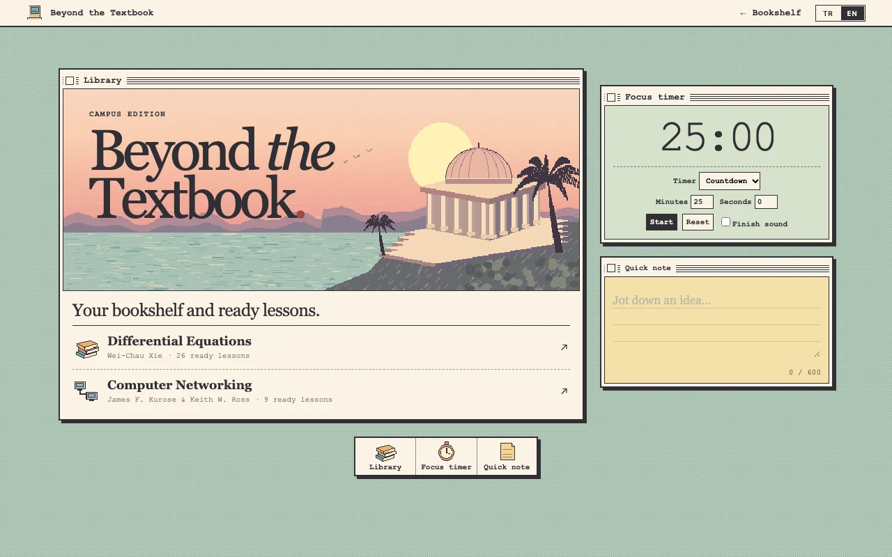
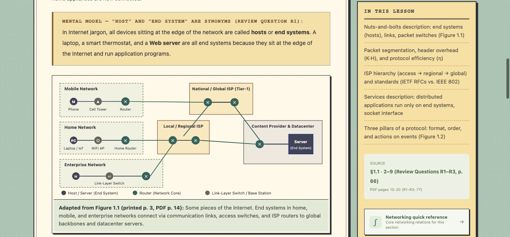

# Beyond the Textbook

An interactive study desk for mathematics and computer networking, in English and Turkish. Pick a textbook, work through a derivation, then test your prediction in a lab. Your notes and progress stay in your browser.

## On the shelf

| Textbook | Ready to study |
| --- | --- |
| *Differential Equations for Engineers* · Wei-Chau Xie | 26 lessons, from first-order equations to Laplace transforms and linear systems |
| *Computer Networking: A Top-Down Approach* · Kurose & Ross, 8th ed. | 9 lessons covering all of Chapter 1 and the principles of network applications (§2.1) |

The first networking lesson traces how home, mobile, and enterprise networks reach a datacenter.

## Run locally

With Node.js installed, run `npm start` and open the local address printed in the terminal. No dependency install or build step is needed. Run `npm test` to check the models, lesson content and lab lifecycle.

[Architecture](ARCHITECTURE.md) · [UI standard](docs/UI-STANDARD.md) · [Project status](docs/PROJE-DURUMU.md)
